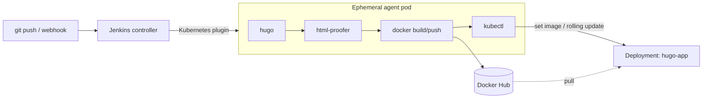

# Jenkins on Kubernetes: pipeline lab (2019)

  

My hands-on lab from 2019, from when I was learning to run **Jenkins agents as ephemeral Kubernetes pods**. Each pipeline asks the Jenkins Kubernetes plugin for a pod made of purpose-built containers, runs its stages in those containers, and lets the pod be torn down when the build finishes.

> This repo merges about a dozen small experiment repos into one place. The pipelines are kept as they were written, with small tidy-ups: no personal identifiers, and the Hugo build step that was left empty is filled in.

## What's inside

| Folder | Pattern | What it shows |
|---|---|---|
| [`01-golang-utility-pod`](01-golang-utility-pod/Jenkinsfile) | Single-container pod template | The basics: `podTemplate` → `node(label)` → `container('golang')`. The build runs in a throwaway toolchain container, not on the Jenkins controller. |
| [`02-selenium-parallel-browsers`](02-selenium-parallel-browsers/Jenkinsfile) | Multi-container pod (sidecars) + `parallel` | A Selenium Grid hub and Chrome/Firefox nodes as sidecars in **one pod**, sharing localhost. Ports are remapped to avoid clashes, and Maven test runs execute against both browsers in parallel. Based on the Kubernetes-plugin Selenium example ([carlossg/selenium-example](https://github.com/carlossg/selenium-example)). |
| [`03-hugo-site-cicd`](03-hugo-site-cicd) | Full CI/CD to Kubernetes | Build a Hugo static site → validate links with `html-proofer` → `docker build` and push (build number + `latest`) → `kubectl set image` for a rolling update. Docker and kube credentials are mounted from Kubernetes **secrets**, not stored in Jenkins. |



## Running the Hugo pipeline

Prerequisites:

1. Jenkins with the [Kubernetes plugin](https://plugins.jenkins.io/kubernetes/), connected to a cluster.
2. Two secrets in the agent namespace:
   ```sh
   kubectl create secret generic kube-config --from-file=config=$HOME/.kube/config
   kubectl create secret generic docker-config --from-file=config.json=$HOME/.docker/config.json
   ```
3. A `hugo-app` Deployment already running (the pipeline updates its image).
4. Set the `DOCKER_HUB_ACCOUNT` environment variable on the job (it defaults to a placeholder).

Then point a Pipeline job at `03-hugo-site-cicd/Jenkinsfile`.

## Looking back (2026)

This lab is where my platform work started. Today I would:

- Use **declarative** pipelines with a `kubernetes { yaml ... }` agent instead of scripted `podTemplate`.
- Replace host Docker-socket mounts with **Kaniko/BuildKit** rootless builds.
- Move deployment to **GitOps** (Argo CD / Flux) instead of `kubectl set image` from CI.
- Pin image tags and digests, and add image scanning (Trivy) and SBOMs.

## Credits

- Hugo theme: [hugo-material-docs](https://github.com/digitalcraftsman/hugo-material-docs) by Digitalcraftsman (MIT). Its license is in `03-hugo-site-cicd/themes/hugo-material-docs/LICENSE.md`.
- Container images used in the Hugo pipeline: `smesch/hugo`, `smesch/html-proofer` and `smesch/kubectl`, from public Jenkins-on-Kubernetes tutorials.

## License

[MIT](LICENSE) for my pipeline code. Third-party content keeps its own license.
